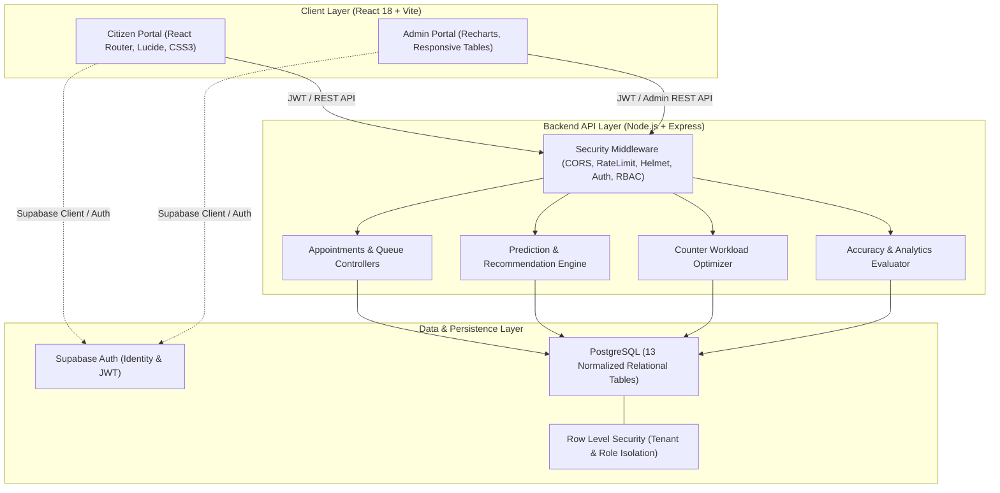
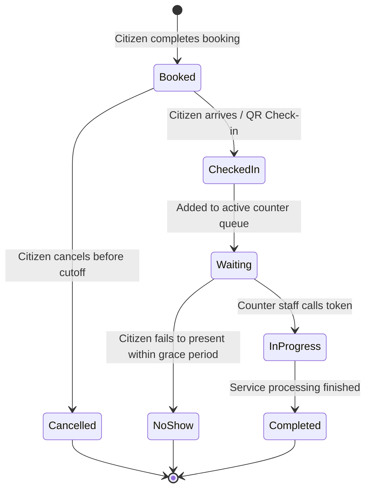

# System Architecture: RTO SmartQueue AI

## 1. System Vision & Academic Scope

**RTO SmartQueue AI** is an intelligent, citizen-centric queue prediction, appointment booking, and operational workload optimization platform designed for Regional Transport Offices (RTOs). 

Traditional appointment booking systems issue fixed time slots without transparency regarding real-time delays, waiting congestion, or counter utilization. This results in unpredictable waiting periods for citizens and uneven workload distribution among RTO counters. RTO SmartQueue AI bridges this gap through:
- A transparent, mathematical wait-time estimation engine.
- A multi-criteria smart slot recommendation system.
- Real-time queue tracking with explainable delay factors.
- Administrator-assisted counter workload balancing and congestion management.
- Closed-loop prediction accuracy analytics (Mean Absolute Error and MAPE).

> [!IMPORTANT]
> **Academic Demonstration Disclaimer**:
> This project is developed as an academic capstone/demonstration project for a third-year Computer Engineering curriculum. It does not represent an official government service, does not claim government affiliation, and does not access official Parivahan/RTO government production databases. All RTO locations, staff profiles, and processing duration standards are strictly demonstration and synthetic data.

---

## 2. High-Level System Architecture

The project employs a modular, clean monorepo architecture separating frontend presentation, backend business logic, queue state management, predictive analytics, and database persistence.



---

## 3. Monorepo Structure

```text
RTO-SmartQueue-AI/
├── bin/                          # Portable developer tooling wrappers (node, npm, git)
├── docs/                         # Architecture, Database, Prediction & QA documentation
│   ├── architecture.md
│   ├── database-schema.md
│   ├── prediction-methodology.md
│   └── testing-report.md
├── backend/                      # Express.js REST API
│   ├── src/
│   │   ├── config/               # Database, auth, and environment configuration
│   │   ├── controllers/          # Request handling & HTTP status mappings
│   │   ├── middleware/           # Auth, RBAC, Rate-limit, error handlers
│   │   ├── routes/               # API route definitions
│   │   ├── services/             # Core business logic:
│   │   │   ├── appointmentService.js
│   │   │   ├── queueService.js
│   │   │   ├── predictionService.js
│   │   │   ├── recommendationService.js
│   │   │   ├── workloadService.js
│   │   │   └── analyticsService.js
│   │   ├── validators/           # Input schemas & payload validation
│   │   ├── utils/                # Token generators, math helpers, logger
│   │   ├── app.js                # Express app definition & middleware wiring
│   │   └── server.js             # HTTP server entrypoint
│   ├── tests/                    # Supertest integration tests & Vitest unit tests
│   ├── package.json
│   └── .env.example
├── frontend/                     # React + Vite Single-Page Application
│   ├── src/
│   │   ├── components/           # Reusable UI (Navbar, Modal, Alert, Cards, Badges)
│   │   ├── layouts/              # CitizenLayout, AdminLayout, AuthLayout
│   │   ├── pages/                # LandingPage, Dashboard, BookingWizard, QueueTracker, AdminPages
│   │   ├── features/
│   │   │   ├── auth/             # Login, Register, Profile, RoleGuard
│   │   │   ├── appointments/     # Booking wizard (8 steps), History, Cancellation
│   │   │   ├── queue/            # Live queue ticket, delay explanations, polling
│   │   │   ├── predictions/      # Wait estimate cards, factor breakdowns
│   │   │   └── admin/            # Counters, Queue manager, Rebalance modal, Analytics
│   │   ├── hooks/                # useAuth, useQueue, usePredictions, useNotifications
│   │   ├── services/             # Axios/fetch API clients & Supabase client
│   │   ├── utils/                # Date formatting, token badge helpers
│   │   └── styles/               # CSS variables, animations, responsive design
│   ├── package.json
│   └── .env.example
├── supabase/                     # Database migrations and seed scripts
│   ├── migrations/
│   │   ├── 001_initial_schema.sql
│   │   └── 002_rls_policies.sql
│   └── seed.sql                  # Comprehensive synthetic demonstration records
├── README.md
└── package.json
```

---

## 4. Key Data Flows

### 4.1 Citizen Booking & Smart Recommendation Flow
1. **Service & Office Selection**: The citizen selects an RTO Office and target service (e.g., *Driving Licence*, *RC Renewal*).
2. **Slot Retrieval & Wait Prediction**: The frontend queries `/api/slots?officeId=...&serviceId=...&date=...`. The backend calculates predicted waiting time for each available slot using current appointment demand, active counter capacity, and configured service durations.
3. **Recommendation Engine**: The backend evaluates all valid slots and classifies three recommendations:
   - **Lowest Wait**: Minimum expected queue delay.
   - **Balanced**: Optimal balance between low wait and reasonable remaining capacity.
   - **Most Convenient**: Earliest available morning or afternoon slot matching the citizen's choice.
4. **Atomic Booking Transaction**: Upon confirmation, the booking request executes inside a transactional atomic capacity check (`SELECT ... FOR UPDATE` or atomic decrement). If capacity is valid, an appointment is confirmed, an unguessable booking reference (`BK-XXXXXXXX`) is assigned, and a daily queue token (`DL-101`) is issued.

### 4.2 Queue Progression Lifecycle
The lifecycle follows strict, validated state transitions:
$$\text{Booked} \longrightarrow \text{Checked In} \longrightarrow \text{Waiting} \longrightarrow \text{In Progress} \longrightarrow \text{Completed}$$
Alternate / terminal states:
- $\text{Booked} \longrightarrow \text{Cancelled}$ (by citizen or admin)
- $\text{Waiting} / \text{Booked} \longrightarrow \text{No Show}$ (marked by admin when citizen fails to appear)



### 4.3 Administrator Counter Workload Balancing Flow
1. **Workload Analysis**: The background / on-demand workload optimizer monitors all active counters.
2. **Congestion Detection**: Counters with queue lengths exceeding the congestion threshold (e.g. $> 4$ waiting citizens or $> 45$ min estimated delay) trigger a congestion flag.
3. **Authorized Reassignment Search**: The engine inspects other active counters that are authorized for the congested service and have spare capacity.
4. **Recommendation Generation**: A recommendation record is generated with a transparent rationale and expected wait reduction (e.g., *"Reassign Counter 3 to support Vehicle Registration; expected wait reduction: 18 min"*).
5. **Admin Approval / Rejection**: An authorized administrator reviews the recommendation in the dashboard and clicks **Approve** or **Reject**.
6. **Transactional Execution**: Approval executes an atomic update linking Counter 3 to the congested service, recalculates queue estimates, and logs the action in `audit_logs`.

---

## 5. Security & Isolation Boundaries

1. **Authentication**: Powered by Supabase Auth (JWT). Client passes `Authorization: Bearer <token>` in API requests.
2. **Role Authorization**:
   - `citizen`: Can only query and mutate their own profile, appointments, and queue tokens.
   - `admin`: Requires verified server-side role check (`profiles.role === 'admin'`). Frontend navigation hiding is reinforced by strict backend middleware (`verifyAdmin`).
3. **Admin Bootstrap Isolation**: Public registration endpoint strictly forces `role = 'citizen'`. The administrator role can only be assigned through:
   - Direct SQL migration / database admin operation, or
   - Controlled server-side bootstrap script (`node backend/src/scripts/bootstrapAdmin.js`) with an environment secret (`ADMIN_BOOTSTRAP_SECRET`).
4. **Concurrency & Race Condition Prevention**:
   - Appointment slot capacity is decremented atomically.
   - Unique constraints on `booking_reference` and `(office_id, token_date, token_number)`.
5. **Network & Secrets Security**:
   - Frontend only accesses the public anonymous Supabase key (`VITE_SUPABASE_ANON_KEY`).
   - Sensitive service-role key (`SUPABASE_SERVICE_ROLE_KEY`) is stored strictly on the backend.
   - Input validation using schema sanitizers.
   - Rate limiting on sensitive endpoints.
