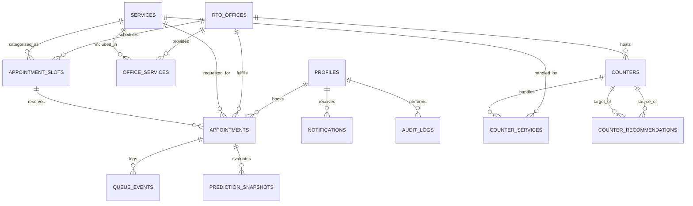

# Database Schema Specification: RTO SmartQueue AI

This document specifies the PostgreSQL relational schema implemented for RTO SmartQueue AI. The schema is designed for deployment on Supabase PostgreSQL with strict foreign key integrity, atomic concurrency protection, check constraints, and Row Level Security (RLS) policies.

---

## 1. Entity-Relationship Overview

---

## 2. Table Definitions

### 2.1 `profiles`
Stores user profile information linked directly to Supabase Auth `auth.users`.
- `id` (UUID, Primary Key, References `auth.users(id)` ON DELETE CASCADE)
- `email` (TEXT, NOT NULL, UNIQUE)
- `full_name` (TEXT, NOT NULL)
- `phone` (TEXT)
- `role` (TEXT, NOT NULL, DEFAULT 'citizen', CHECK `role IN ('citizen', 'admin')`)
- `created_at` (TIMESTAMPTZ, DEFAULT NOW())
- `updated_at` (TIMESTAMPTZ, DEFAULT NOW())

### 2.2 `rto_offices`
Demonstration RTO offices.
- `id` (UUID, Primary Key, DEFAULT gen_random_uuid())
- `office_code` (TEXT, NOT NULL, UNIQUE) e.g., 'MH-01' (Mumbai Central), 'MH-12' (Pune)
- `office_name` (TEXT, NOT NULL)
- `address` (TEXT, NOT NULL)
- `city` (TEXT, NOT NULL)
- `state` (TEXT, NOT NULL)
- `timezone` (TEXT, NOT NULL, DEFAULT 'Asia/Kolkata')
- `operating_hours_start` (TIME, NOT NULL, DEFAULT '09:00:00')
- `operating_hours_end` (TIME, NOT NULL, DEFAULT '17:00:00')
- `is_active` (BOOLEAN, NOT NULL, DEFAULT true)
- `created_at` (TIMESTAMPTZ, DEFAULT NOW())

### 2.3 `services`
RTO service definitions.
- `id` (UUID, Primary Key, DEFAULT gen_random_uuid())
- `service_code` (TEXT, NOT NULL, UNIQUE) e.g. 'DL', 'LL', 'VR', 'TO', 'RC'
- `name` (TEXT, NOT NULL) e.g. 'Driving Licence', 'Learner\'s Licence', 'Vehicle Registration', 'Ownership Transfer', 'RC Renewal'
- `description` (TEXT)
- `estimated_duration_minutes` (INTEGER, NOT NULL, CHECK `estimated_duration_minutes > 0`)
- `appointment_quota_per_slot` (INTEGER, NOT NULL, DEFAULT 5, CHECK `appointment_quota_per_slot > 0`)
- `is_active` (BOOLEAN, NOT NULL, DEFAULT true)
- `created_at` (TIMESTAMPTZ, DEFAULT NOW())

### 2.4 `office_services`
Associative table linking offices to supported services with local overrides.
- `id` (UUID, Primary Key, DEFAULT gen_random_uuid())
- `office_id` (UUID, NOT NULL, References `rto_offices(id)` ON DELETE CASCADE)
- `service_id` (UUID, NOT NULL, References `services(id)` ON DELETE CASCADE)
- `custom_duration_minutes` (INTEGER)
- `is_active` (BOOLEAN, NOT NULL, DEFAULT true)
- `created_at` (TIMESTAMPTZ, DEFAULT NOW())
- CONSTRAINT: `UNIQUE(office_id, service_id)`

### 2.5 `counters`
Physical or virtual service counters at an RTO office.
- `id` (UUID, Primary Key, DEFAULT gen_random_uuid())
- `office_id` (UUID, NOT NULL, References `rto_offices(id)` ON DELETE CASCADE)
- `counter_number` (INTEGER, NOT NULL) e.g., 1, 2, 3
- `counter_label` (TEXT, NOT NULL) e.g., 'Counter 1 - Fast Track DL'
- `status` (TEXT, NOT NULL, DEFAULT 'active', CHECK `status IN ('active', 'busy', 'paused', 'offline')`)
- `current_appointment_id` (UUID)
- `created_at` (TIMESTAMPTZ, DEFAULT NOW())
- CONSTRAINT: `UNIQUE(office_id, counter_number)`

### 2.6 `counter_services`
Many-to-many relationship mapping which services a counter is authorized to process.
- `id` (UUID, Primary Key, DEFAULT gen_random_uuid())
- `counter_id` (UUID, NOT NULL, References `counters(id)` ON DELETE CASCADE)
- `service_id` (UUID, NOT NULL, References `services(id)` ON DELETE CASCADE)
- `created_at` (TIMESTAMPTZ, DEFAULT NOW())
- CONSTRAINT: `UNIQUE(counter_id, service_id)`

### 2.7 `appointment_slots`
Time windows for citizen appointments.
- `id` (UUID, Primary Key, DEFAULT gen_random_uuid())
- `office_id` (UUID, NOT NULL, References `rto_offices(id)` ON DELETE CASCADE)
- `service_id` (UUID, NOT NULL, References `services(id)` ON DELETE CASCADE)
- `slot_date` (DATE, NOT NULL)
- `start_time` (TIME, NOT NULL)
- `end_time` (TIME, NOT NULL)
- `max_capacity` (INTEGER, NOT NULL, CHECK `max_capacity > 0`)
- `booked_count` (INTEGER, NOT NULL, DEFAULT 0, CHECK `booked_count >= 0 AND booked_count <= max_capacity`)
- `is_active` (BOOLEAN, NOT NULL, DEFAULT true)
- CONSTRAINT: `UNIQUE(office_id, service_id, slot_date, start_time)`

### 2.8 `appointments`
Citizen bookings and queue records.
- `id` (UUID, Primary Key, DEFAULT gen_random_uuid())
- `user_id` (UUID, NOT NULL, References `profiles(id)` ON DELETE RESTRICT)
- `office_id` (UUID, NOT NULL, References `rto_offices(id)` ON DELETE RESTRICT)
- `service_id` (UUID, NOT NULL, References `services(id)` ON DELETE RESTRICT)
- `slot_id` (UUID, NOT NULL, References `appointment_slots(id)` ON DELETE RESTRICT)
- `counter_id` (UUID, References `counters(id)` ON DELETE SET NULL)
- `booking_reference` (TEXT, NOT NULL, UNIQUE)
- `queue_token` (TEXT, NOT NULL) e.g., 'DL-101'
- `token_number` (INTEGER, NOT NULL)
- `token_date` (DATE, NOT NULL)
- `status` (TEXT, NOT NULL, DEFAULT 'booked', CHECK `status IN ('booked', 'checked_in', 'waiting', 'in_progress', 'completed', 'cancelled', 'no_show')`)
- `notes` (TEXT)
- `checked_in_at` (TIMESTAMPTZ)
- `service_started_at` (TIMESTAMPTZ)
- `service_completed_at` (TIMESTAMPTZ)
- `predicted_wait_at_checkin` (NUMERIC(5,2))
- `actual_wait_minutes` (NUMERIC(5,2))
- `actual_service_minutes` (NUMERIC(5,2))
- `created_at` (TIMESTAMPTZ, DEFAULT NOW())
- `updated_at` (TIMESTAMPTZ, DEFAULT NOW())
- CONSTRAINT: `UNIQUE(office_id, token_date, queue_token)`

### 2.9 `queue_events`
Audit log of all queue lifecycle transitions.
- `id` (UUID, Primary Key, DEFAULT gen_random_uuid())
- `appointment_id` (UUID, NOT NULL, References `appointments(id)` ON DELETE CASCADE)
- `from_status` (TEXT)
- `to_status` (TEXT, NOT NULL)
- `actor_id` (UUID, References `profiles(id)` ON DELETE SET NULL)
- `metadata` (JSONB, DEFAULT '{}')
- `created_at` (TIMESTAMPTZ, DEFAULT NOW())

### 2.10 `prediction_snapshots`
Record of wait time estimations for audit, accuracy tracking, and model validation.
- `id` (UUID, Primary Key, DEFAULT gen_random_uuid())
- `appointment_id` (UUID, References `appointments(id)` ON DELETE CASCADE)
- `office_id` (UUID, NOT NULL, References `rto_offices(id)`)
- `service_id` (UUID, NOT NULL, References `services(id)`)
- `predicted_wait_minutes` (NUMERIC(5,2), NOT NULL)
- `lower_bound_minutes` (NUMERIC(5,2), NOT NULL)
- `upper_bound_minutes` (NUMERIC(5,2), NOT NULL)
- `confidence_score` (NUMERIC(3,2), NOT NULL)
- `confidence_label` (TEXT, NOT NULL)
- `factors_used` (JSONB, NOT NULL)
- `data_basis` (TEXT, NOT NULL)
- `created_at` (TIMESTAMPTZ, DEFAULT NOW())

### 2.11 `counter_recommendations`
Smart workload balancing recommendations generated by the optimization engine.
- `id` (UUID, Primary Key, DEFAULT gen_random_uuid())
- `office_id` (UUID, NOT NULL, References `rto_offices(id)` ON DELETE CASCADE)
- `service_id` (UUID, NOT NULL, References `services(id)` ON DELETE CASCADE)
- `source_counter_id` (UUID, References `counters(id)` ON DELETE CASCADE)
- `target_counter_id` (UUID, NOT NULL, References `counters(id)` ON DELETE CASCADE)
- `recommendation_type` (TEXT, NOT NULL) e.g., 'REASSIGN_COUNTER', 'OPEN_BACKUP'
- `rationale` (TEXT, NOT NULL)
- `expected_wait_reduction_minutes` (NUMERIC(5,2), NOT NULL)
- `status` (TEXT, NOT NULL, DEFAULT 'pending', CHECK `status IN ('pending', 'approved', 'rejected')`)
- `reviewed_by` (UUID, References `profiles(id)`)
- `reviewed_at` (TIMESTAMPTZ)
- `created_at` (TIMESTAMPTZ, DEFAULT NOW())

### 2.12 `notifications`
In-app citizen alerts for booking, status changes, and major queue delays.
- `id` (UUID, Primary Key, DEFAULT gen_random_uuid())
- `user_id` (UUID, NOT NULL, References `profiles(id)` ON DELETE CASCADE)
- `appointment_id` (UUID, References `appointments(id)` ON DELETE SET NULL)
- `notification_type` (TEXT, NOT NULL) e.g., 'BOOKING_CONFIRMED', 'STATUS_CHANGED', 'WAIT_TIME_UPDATE'
- `title` (TEXT, NOT NULL)
- `message` (TEXT, NOT NULL)
- `is_read` (BOOLEAN, NOT NULL, DEFAULT false)
- `created_at` (TIMESTAMPTZ, DEFAULT NOW())

### 2.13 `audit_logs`
Immutable administrative audit log.
- `id` (UUID, Primary Key, DEFAULT gen_random_uuid())
- `actor_id` (UUID, References `profiles(id)` ON DELETE SET NULL)
- `action` (TEXT, NOT NULL) e.g., 'APPROVE_COUNTER_REASSIGNMENT', 'UPDATE_COUNTER_STATUS', 'MARK_NO_SHOW'
- `target_type` (TEXT, NOT NULL) e.g., 'counter', 'appointment', 'service'
- `target_id` (TEXT, NOT NULL)
- `change_summary` (JSONB, NOT NULL)
- `ip_address` (TEXT)
- `created_at` (TIMESTAMPTZ, DEFAULT NOW())

---

## 3. Row Level Security (RLS) Strategy

- **`profiles`**:
  - `SELECT`: Self (`auth.uid() = id`) OR Admin (`EXISTS (SELECT 1 FROM profiles WHERE id = auth.uid() AND role = 'admin')`).
  - `UPDATE`: Self (non-role fields only) OR Admin.
  - `INSERT`: Trigger-based upon `auth.users` creation.
- **`appointments`**:
  - `SELECT`: Citizen can view only their own appointments (`auth.uid() = user_id`); Admins can view all.
  - `INSERT`: Authenticated citizen can book for self (`auth.uid() = user_id`).
  - `UPDATE`: Citizen can cancel/reschedule their own appointment if status is 'booked'; Admins can update status, counter, and notes.
- **`notifications`**:
  - Citizens can only read and mark read their own notifications (`auth.uid() = user_id`).
- **`rto_offices`, `services`, `appointment_slots`**:
  - `SELECT`: Public / authenticated read.
  - `INSERT / UPDATE / DELETE`: Admin only.
- **`counter_recommendations`, `audit_logs`**:
  - Admin only.
